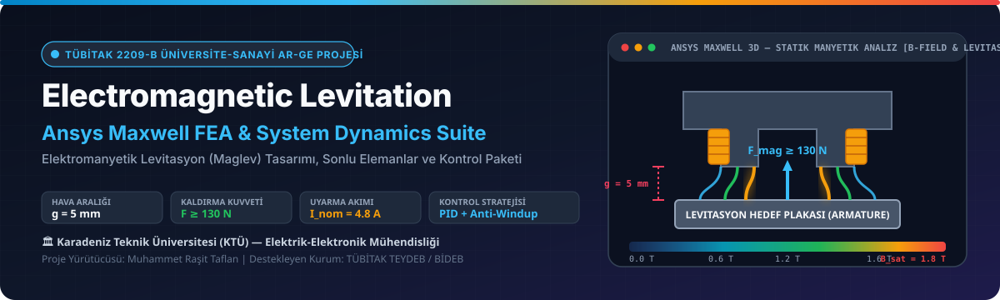
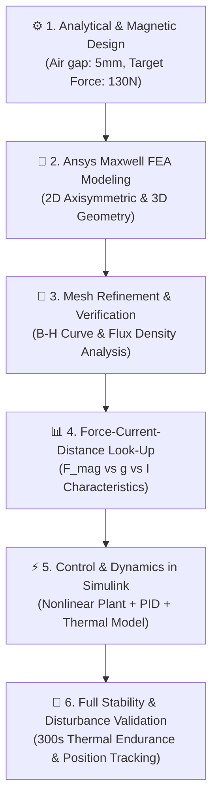
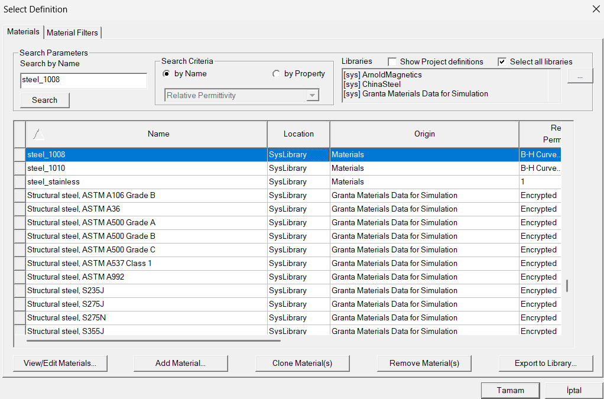
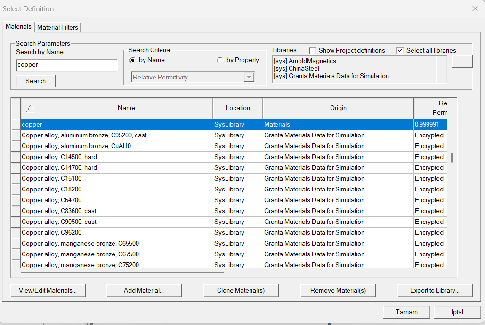

# Electromagnetic Levitation (Maglev) — Finite Element Analysis (FEA) & System Dynamics Suite
### (Elektromanyetik Levitasyon Maglev — Sonlu Elemanlar Analizi FEA ve Sistem Dinamiği Paketi)

<div align="center">



<br/>

[](#)
[](#)
[](#)
[](#)

<br/>

[-Maglev_Canli_Hesaplayici.html-2563eb?style=for-the-badge)](https://rasittaflan.github.io/Electromagnetic-Levitation-FEA-Simulations/Maglev_Canli_Hesaplayici.html)

<br/>

### 🌐 [**🇬🇧 English Documentation**](#english-documentation) &nbsp;&nbsp;|&nbsp;&nbsp; [**🇹🇷 Türkçe Dokümantasyon**](#turkce-dokumantasyon)

</div>

---

<a id="english-documentation"></a>

# 🇬🇧 Electromagnetic Levitation System Design & FEA Simulation Suite
### *(Elektromanyetik Levitasyon Sistemi Tasarım ve FEA Simülasyon Paketi)*

> **Comprehensive electromagnetic, finite element analysis (FEA), and closed-loop control dynamics package for an industrial-grade Electromagnetic Levitation (Maglev) system**, developed within the scope of the **TÜBİTAK 2209-B University-Industry Collaborative Research Project** at **Karadeniz Technical University (KTU)**.

---

## 🚀 Live Interactive Maglev Calculator / Canlı Etkileşimli Hesaplayıcı

> [!TIP]
> Click the button below to launch the **100% interactive web calculator** directly in your browser without any installation:  
> 👉 [**🚀 Launch Live Maglev Design Studio (Canlı Tasarım Stüdyosunu Başlat)**](https://rasittaflan.github.io/Electromagnetic-Levitation-FEA-Simulations/Maglev_Canli_Hesaplayici.html)

You can modify coil turns ($N$), excitation current ($I$), air gap ($g$), and pole area in real time to calculate the magnetic lifting force ($F_{mag}$), flux density ($B$), and verify system equilibrium.

---

## ✨ Project Overview & Highlights / Proje Özeti ve Başarımları

| Parameter / Parametre | Specification / Değer | Engineering Impact / Mühendislik Etkisi |
| :--- | :--- | :--- |
| **Target Working Air Gap ($g$)** / Hedef Hava Aralığı | **$5\text{ mm}$** | Stable levitation operating point for industrial conveyor/transport applications. *(Kararlı çalışma noktası)* |
| **V1 Verified Force ($F_{em, V1}$)** / Doğrulanmış V1 Kuvveti | **$0.4823\text{ N}$ @ $4.8\text{ A}$**<br/>($22.26\text{ mN}$ @ $1.0\text{ A}$) | Single cylindrical Steel 1008 actuator (r=5mm, L=30mm), verified via Ansys Maxwell 2D/3D FEA. *(Doğrulanmış PID prototipi)* |
| **V2 High-Force Target ($F_{target}$)** / V2 Tasarım Hedefi | **$\ge 130\text{ N}$ (Hedef)** | Research design target for high-force U-core distributed pod actuator array. *(Planlanan araç entegrasyonu)* |
| **Excitation Current ($I_{nom}$)** / Nominal Uyarım Akımı | **$4.8\text{ A}$** | Optimized for thermal durability and conductor current density limits ($J \le 4.5\text{ A/mm}^2$). *(Isıl dayanım)* |
| **Core Material** / Nüve Malzemesi | **Silicon Steel / Soft Magnetic** | High magnetic saturation flux density ($B_{sat} \approx 1.8\text{ T}$) minimizing core losses. *(Düşük kayıp)* |
| **Control Strategy** / Kontrol Algoritması | **PID + Anti-Windup + Limiter** | Real-time position tracking and disturbance rejection under external load variations. *(Konum takibi)* |

---

## 🧭 System Architecture & Multiphysics Workflow / Sistem Mimarisi



---

## 🔬 Finite Element Analysis (FEA) Highlights / FEA Analiz Bulguları

### 1. Static Magnetic Field & Flux Density Distribution / Manyetik Akı Dağılımı
- **Finite Element Solver:** Ansys Maxwell 2D (Axisymmetric) and 3D Magnetostatic Solver.
- **Air Gap Analysis:** Parametric sweep conducted across $1\text{ mm} \le g \le 10\text{ mm}$.
- **Flux Leakage Reduction:** Optimized pole face geometry to focus the magnetic flux lines directly into the levitated target armature.

<div align="center">
  
  <p><em>Figure 1: Magnetic flux density (B-Field) contour and flux lines across the E-core / U-core electromagnet and 5 mm air gap.</em></p>
</div>

### 2. Mesh Refinement & Finite Element Convergence / Mesh Hassasiyeti
Energy error and mesh refinement iterations were conducted in Ansys Maxwell to ensure that the finite element mesh reaches convergence without singular field anomalies:

<div align="center">
  
  <p><em>Figure 2: Mesh discretization and element distribution across the core, coils, and air-gap boundary.</em></p>
</div>

---

## 📁 Repository Structure / Depo Klasör Mimarisi

| File / Dosya | Format | Live Launch / Canlı Aç | Purpose & Capabilities / Amaç ve Kapsam |
| :--- | :---: | :---: | :--- |
| **[`index.html`](./index.html)** | `HTML5 / Three.js` | [**🚀 Launch 3D Studio**](https://rasittaflan.github.io/Electromagnetic-Levitation-FEA-Simulations/) | **3D Digital Twin & FEA Studio:** TÜBİTAK 2209-B Hyperloop ve Silindirik V1 Elektromıknatıs 3B simülasyon ortamı. |
| **[`Maglev_Canli_Hesaplayici.html`](./Maglev_Canli_Hesaplayici.html)** | `HTML5 / Three.js` | [**🚀 Launch Live**](https://rasittaflan.github.io/Electromagnetic-Levitation-FEA-Simulations/Maglev_Canli_Hesaplayici.html) | **Interactive Maglev Design Studio:** Canlı hava aralığı, akım, sarım sayısı ve manyetik kaldırma kuvveti ($F_{mag}$) hesaplayıcısı. |
| **[`T2209EM_V1_4p8A_Dogrulama.aedt`](./simulations/ansys_maxwell/T2209EM_V1_4p8A_Dogrulama.aedt)** | `Ansys AEDT` | — | Ansys Maxwell 2D/3D doğrulanmış sonlu elemanlar magnetostatik simülasyon modeli. |
| **[`TUBITAK_Maglev_Ekip_Sunumu_Final.slx`](./simulations/matlab_simulink/TUBITAK_Maglev_Ekip_Sunumu_Final.slx)** | `Simulink` | — | Doğrusal olmayan levitasyon dinamiği, PID ve termal dayanım Simulink kapalı çevrim modeli. |

```text
Electromagnetic-Levitation-FEA-Simulations/
├── assets/                                 # FEA flux contours, B-H curves, and banner
│   ├── banner.svg                          # High-res vector architecture banner
│   ├── image4.png                          # 2D/3D B-Field flux density distribution
│   └── image10.png                         # Mesh verification & convergence plot
├── docs/                                   # Full technical reports & research proposals
│   └── TUBITAK_2209_28-09-2026_Elektromanyetik_Levitasyon_Ansys_Maxwell_FEA_V1_Raporu.docx
├── simulations/
│   ├── ansys_maxwell/                      # 2D/3D FEA Maxwell designs (.aedt)
│   │   ├── T2209EM_V1_4p8A_Dogrulama.aedt
│   │   ├── T2209EM_V1_4p8A_MeshDogrulama.aedt
│   │   └── T2209EM_V1_4p8A_MeshTest.aedt
│   └── matlab_simulink/                    # System dynamics & PID closed-loop models
├── Maglev_Canli_Hesaplayici.html           # 100% Offline Interactive Maglev Calculator & Studio
├── .gitignore                              # Clean repository filter for FEA/MATLAB artifacts
└── README.md                               # Master technical documentation
```

---

<a id="turkce-dokumantasyon"></a>

# 🇹🇷 Elektromanyetik Levitasyon (Maglev) Sistemi Tasarım ve FEA Simülasyon Paketi

> **TÜBİTAK 2209-B Sanayiye Yönelik Lisans Araştırma Projeleri Destekleme Programı** kapsamında **Karadeniz Teknik Üniversitesi (KTÜ)** Elektrik-Elektronik Mühendisliği bünyesinde geliştirilmiş; sonlu elemanlar analizi (FEA), manyetik optimizasyon ve kapalı çevrim kontrol dinamiklerini içeren kapsamlı mühendislik çalışma paketi.

---

## 🎯 Projenin Amacı ve Teknik Başarımları

1. **Manyetik Doğrulama (V1):** $5\text{ mm}$ hedef hava aralığında tekil silindirik aktüatör ile $1.0\text{ A}$ uyarımda $22.255\text{ mN}$, $4.8\text{ A}$ nominal uyarımda $0.48233\text{ N}$ kaldırma kuvveti Ansys Maxwell 2D/3D modelleri ile nümerik olarak doğrulanmıştır. Çoklu aktüatör ve yüksek kuvvet ($\ge 130\text{ N}$) V2 geliştirme aşaması tasarım hedefi olarak belirlenmiştir.
2. **Mesh ve Çözücü Yakınsaması:** Farklı mesh yoğunlukları test edilerek enerji hatası minimize edilmiş, manyetik akı yoğunluğu doyum sınırları ($B \le 1.8\text{ T}$) içinde tutulmuştur.
3. **Sistem Dinamiği ve Kararlılık:** Ansys simülasyonlarından elde edilen doğrusal olmayan kuvvet-akım-mesafe karakteristikleri MATLAB/Simulink ortamına aktarılmış; PID + Anti-Windup denetleyici ile 300 saniyelik sürekli çalışma ve ısıl dayanım testleri gerçekleştirilmiştir.

---

## 👨‍💻 Mühendislik Ekibi ve Katkıda Bulunanlar

* **Muhammet Raşit Taflan** — *Proje Yürütücüsü / Manyetik FEA & Donanım Tasarımı* (KTÜ EEM)
* **Süleyman Hızarcı** — *Kontrol Dinamiği & Simulink Modellemesi*
* **Doğukan Çağatay** — *Nüve & Malzeme Analizi*
* **Muhammadamin Qodirov** — *Güç Elektroniği & Sürücü Topolojisi*

---

<div align="center">

**Developed with Ansys Maxwell, MATLAB/Simulink & Passion for Engineering ⚡**  
**[⬆ Back to Top / Başa Dön](#english-documentation)**

</div>

